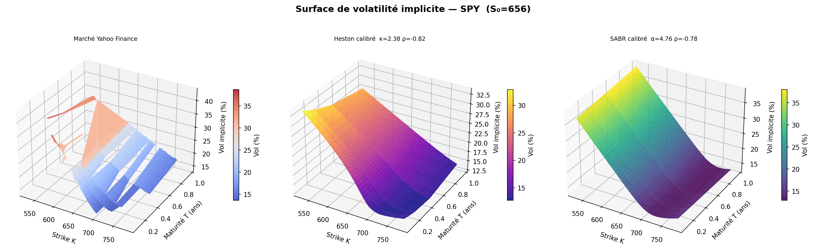
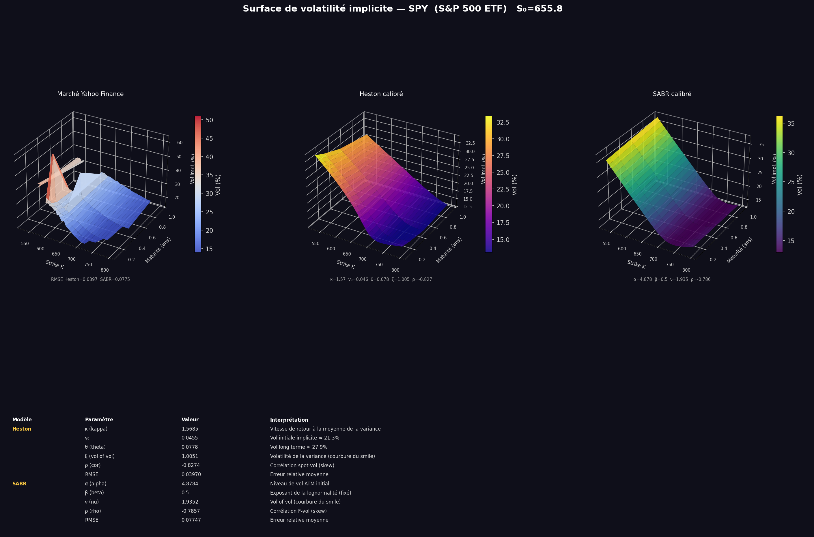

# Heston & SABR Option Pricing — C++ with Python bindings

Fast European option pricing under the **Heston stochastic-volatility model** (via the **Carr–Madan FFT** method) and the **SABR model** (Hagan et al. 2002 implied-vol formula). The pricing library is written in C++17, exposed to Python with pybind11, and used to **calibrate both models to live option chains** (SPY, AAPL, NVDA, GLD, TSLA) from Yahoo Finance.


<p align="center">
  
</p>

## Features

- **Heston characteristic function** and **Carr–Madan FFT** pricing, with Simpson weights, over a whole strike grid in one pass.
- **SABR** implied volatility (Hagan) and Black–Scholes call prices, with full smile generation.
- **Python module `heston`** (pybind11) exposing `Heston`, `HestonParams`, `HestonMarket`, `Sabr`, `SabrParams` and `SabrMarket`.
- **Market calibration** of Heston (5 params) and SABR (α, ρ, ν with fixed β) on real option data, using L-BFGS-B and differential evolution.
- **Unit tests** (GoogleTest, 29 tests) and **micro-benchmarks** (Google Benchmark).

## Project layout

```
include/        Public headers: heston.hpp, sabr.hpp, fft.hpp
src/            Library sources (Heston CF + Carr–Madan, radix-2 FFT, SABR) and a demo executable
python/         pybind11 bindings, calibration and plotting scripts
tests/          GoogleTest unit tests
benchmarks/     Google Benchmark micro-benchmarks
```

## Build

Requirements: CMake ≥ 3.20, a C++17 compiler (Clang or GCC) and Python 3 with its headers. GoogleTest, pybind11 and Google Benchmark are fetched automatically by CMake.

```bash
cmake -S . -B build -DCMAKE_BUILD_TYPE=Release
cmake --build build -j
```

This produces:

| Target | Description |
| --- | --- |
| `build/heston_pricer` | Demo: prices an ATM call (S0=100, K=100, T=1, r=5%) |
| `build/heston_tests` | Unit tests |
| `build/heston_benchmarks` | Benchmarks |
| `build/heston.cpython-*.so` | Python module |

```bash
./build/heston_pricer                  # Heston Call Price (S0=100, K=100, T=1, r=5%): 10.394759
ctest --test-dir build --output-on-failure
./build/heston_benchmarks
```

> The Python scripts import the module from `build/`, so keep that build directory name.
> The module only loads with the same Python version (and CPU architecture) CMake built it against.
> To pick one, add `-DPYTHON_EXECUTABLE=$(which python3)` to the configure command.

## Python usage

```python
import sys; sys.path.insert(0, "build")
import heston

p   = heston.HestonParams(kappa=2.0, v0=0.04, theta=0.04, vol=0.3, cor=-0.7)
mkt = heston.HestonMarket(S0=100.0, r=0.05, T=1.0, q=0.0, params=p)

h = heston.Heston()
print(h.call_price(mkt, K=100.0))            # single strike (N=4096, eta=0.25, alpha=1.5 by default)
log_strikes, prices = h.call_grid(mkt)       # whole FFT strike grid
print(p.feller_ok())                         # 2·kappa·theta > vol²

s  = heston.Sabr()
sp = heston.SabrParams(alpha=0.3, beta=0.5, rho=-0.3, nu=0.4)
sm = heston.SabrMarket(F=100.0, T=1.0, r=0.05)
print(s.implied_vol(sp, sm, K=110.0))
```

## Calibration to market data

```bash
pip install -r python/requirements.txt
cd python
python multi_calibration.py SPY NVDA       # one or more of SPY AAPL NVDA GLD TSLA, or no args for a menu
python market_vol_surface.py               # SPY: market vs Heston vs SABR surface
python vol_surface.py                      # model-only surfaces with fixed parameters
```

Each run downloads option chains for maturities of about 30, 60, 90, 180 and 365 days. It keeps liquid calls within roughly ±20% of spot, fits both models by minimising the relative price RMSE, and saves a plot such as `calibration_SPY.png`. Fitted parameters from one run are stored in [`python/calibration_results.json`](python/calibration_results.json). Market data changes every day, so your results will differ.

<p align="center">
  
</p>

## Method

**Heston (1993)**

$$dS_t = (r-q)S_t\,dt + \sqrt{v_t}\,S_t\,dW^S_t,\qquad dv_t = \kappa(\theta - v_t)\,dt + \sigma\sqrt{v_t}\,dW^v_t,\qquad d\langle W^S,W^v\rangle_t = \rho\,dt$$

The call price is computed from the characteristic function with the **Carr & Madan (1999)** damped-transform method: the damped call price $e^{\alpha k}C(k)$ is Fourier-transformed, then evaluated on $N$ log-strikes at once with an FFT. Spacing is $\eta$ in frequency and $\lambda = 2\pi/(N\eta)$ in log-strike.

**SABR**: Black implied volatility from the Hagan et al. (2002) asymptotic expansion, priced with Black–Scholes.

## References

- S. Heston, *A Closed-Form Solution for Options with Stochastic Volatility*, Review of Financial Studies, 1993.
- P. Carr & D. Madan, *Option Valuation Using the Fast Fourier Transform*, Journal of Computational Finance, 1999.
- P. Hagan, D. Kumar, A. Lesniewski & D. Woodward, *Managing Smile Risk*, Wilmott Magazine, 2002.

---

Research project, Ensimag (Grenoble INP). Code comments are in French.
